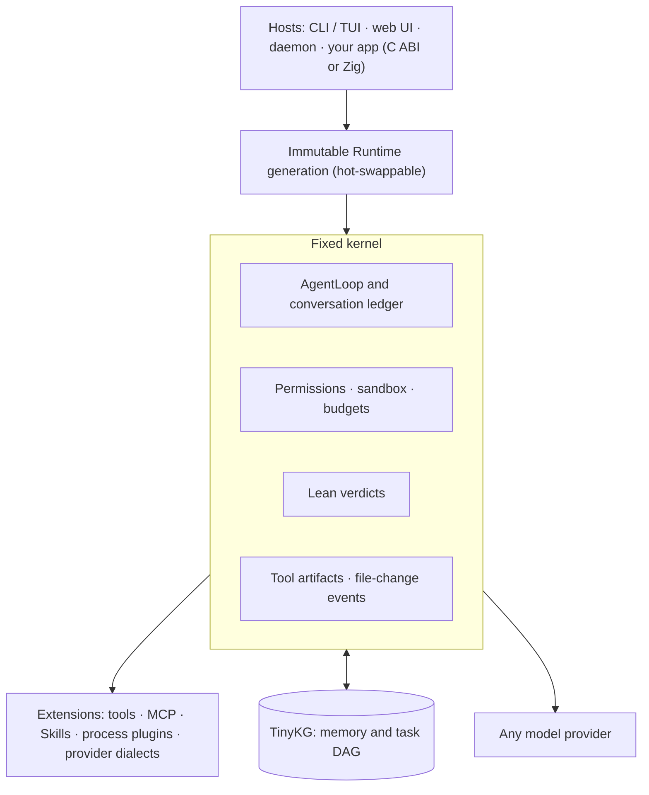

<div align="center">

# metacodes

**The agent harness you can embed anywhere.**

Benchmarked on WorkBuddy-Bench against CodeBuddy Code and Claude Code · a 5.5 MB native binary · a fixed kernel no plugin can bypass · graph memory · a C ABI for every host

[](https://github.com/metask-ai/metacodes/actions/workflows/ci.yml)
[](https://github.com/metask-ai/metacodes/releases)
[](LICENSE)
[](https://ziglang.org)

**English** · [简体中文](README.zh-CN.md)

</div>

metacodes is a coding-agent harness written from scratch in Zig. You can use
it today as a terminal agent, but it is built as a library: one fixed agent
loop, with permissions, budgets and formal checks that no plugin can bypass,
inside surfaces that let any program host it. Those surfaces are a Zig module,
a C ABI (callable from C, C++, Rust, Python, Node and anything else with an
FFI), headless NDJSON, an HTTP/UDS daemon and a web UI.

## Why another harness

Agents are leaving the terminal. They are moving into editors and desktop apps,
CI pipelines, browsers, games and edge devices, and into fleets of hundreds of
workers splitting one job. There the harness is no longer an app you open. It
is infrastructure you embed, and it runs many copies at once.

Most harnesses today are applications: often a Node or Python runtime, tens
to hundreds of megabytes of memory before the first token, and a loop you can
configure but not link into your own program. metacodes takes the opposite
position:

- **The harness is a library.** The CLI is one host among many; your product
  can be the next one.
- **The kernel is fixed and checkable.** Extensions add capability. They never
  get to loosen safety, budgets or verdicts.
- **Every claim is measured.** Benchmarks are bound to receipts, paid runs to a
  budget journal, and null results are published as nulls.

## The numbers

Measured 2026-10-18 on Apple Silicon (macOS), ReleaseSmall build of `main`,
except the two rows that name another source:

| | metacodes |
|---|---|
| Core binary | 5.5 MB (2.6 MB gzipped) |
| Warm start (`--help`) | 5–7 ms |
| Idle process, peak RSS | 2.7 MB |
| One headless run, 20 tool rounds against a local mock model | 23 MB peak RSS |
| Complete release unit: CLI, TinyKG CLI and daemon, two Lean kernels, ripgrep | 16.5–20.8 MB archive (0.5.0 release assets) |
| Sealed gateway, 64 concurrent clients, mock model (2026-10-16, Windows 11, ReleaseFast) | 1,835 agent steps/s; 3 ms p50 / 9 ms p99 gateway cost per step |
| Native targets | Linux x86_64 and arm64, macOS arm64 and x86_64, Windows x86_64 |

For scale, on the same machine the `--help` peak RSS of Codex CLI 0.163 is
20 MB and of Claude Code 2.1.278 is 121 MB. Method and caveats are in
[doc/BENCHMARKS.md](doc/BENCHMARKS.md#footprint-snapshot).

## Quality: measured against the leading harnesses

[WorkBuddy-Bench](https://workbuddybench.com/) (Tencent) scores coding agents
end to end on real repository, web, office and security tasks. Its leaderboard
shows the same model scoring very differently under different harnesses. With
the same model, GLM-5.2:

| Harness | Code | Web\* | Office\* | Security |
|---|---:|---:|---:|---:|
| **metacodes 0.1.0** (self-run, 1 pass, 260/260 tasks) | 72.7 | 81.1 | 78.8 | 59.0 |
| CodeBuddy Code 2.109.3 (official v1.2, 3-run mean) | 71.5 | 67.4 | 79.6 | — |
| Claude Code 2.1.187 (official v1.2, 3-run mean) | 77.1 | 60.7 | 79.6 | — |

\* Not comparable across rows: our Web and Office tasks were judged by
gpt-5.6-sol at temperature 0, the leaderboard's by
[Kimi K2.7 Code](https://github.com/Tencent/workbuddy-bench/issues/3).

Code, which hidden tests score, is the like-for-like column, and there
metacodes lands between the two official harnesses. Security trails an
earlier leaderboard snapshot, which listed GLM-5.2 at 76.3 and 80.9. Even the
Code number is an indication, not a ranking:

- Ours is one self-run diagnostic pass against three-run means. The sealed
  cohort had been inspected before it, and 10 of 17 budget transactions did
  not close their post-run audit.
- The run did not follow the official protocol: temperature 0, no
  reasoning-effort setting, and WebSearch and AskUserQuestion left on.
- Headless metacodes caps a run at 400 turns where both official harnesses
  use 256; no trial in that run reached the cap.

A protocol-aligned three-run evaluation is being prepared in
[#316](https://github.com/metask-ai/metacodes/pull/316).

The full audit is in
[evals/benchmarks/2026-09-12-metacodes-takeover-audit](evals/benchmarks/2026-09-12-metacodes-takeover-audit/report.md).
The [Security trajectory study](evals/benchmarks/2026-09-12-security-trajectory-research/report.md)
traces the gap and found scorer defects that we reported upstream
([Tencent/workbuddy-bench#20](https://github.com/Tencent/workbuddy-bench/issues/20)).
Closing the Security gap is one of the most useful things a contributor can do.

## What's inside

### A fixed kernel, open everywhere else

The kernel owns the agent loop and conversation ledger, tool ordering and
cancellation, plus permissions, budgets, formal verdicts and memory admission.
Everything else is an extension, and extensions can only narrow policy, never
widen it. A misbehaving plugin cannot approve its own tool call, raise its own
budget or fake a verdict.

### Plugin flexibility on the DeepSeek Harness model, minus the replaceable loop

metacodes adopted the strongest composition ideas of
[DeepSeek Harness](https://github.com/deepseek-ai/deepseek-harness)'s Cordis
runtime:

- stable service identities with declared dependencies;
- plugin-owned effects that unwind in reverse order on failure;
- ordered profiles and bundles.

It implements them over immutable Runtime generations:

- **Hot-swap.** Swap a whole capability profile (`minimal`, `offline-coding`,
  `coding`, ...) in one transactional publish. Running sessions stay pinned to
  the generation they started on.
- **Four plugin kinds.**
  - static trusted plugins with a typed service graph;
  - data plugins (manifests, Skills);
  - process plugins in any language: hash-pinned, with strict framing,
    timeouts and output caps;
  - provider-dialect plugins.
- **Stable prompt cache.** The request the model sees is a deterministic
  projection of tools, conversation and dialect. Plugin ids, load paths,
  timestamps and journals never enter it, so an equivalent runtime swap keeps
  the provider's prompt cache warm.

See [PLUGIN_ARCHITECTURE](doc/PLUGIN_ARCHITECTURE.md),
[CORE_PLUGIN_HOTSWAP](doc/CORE_PLUGIN_HOTSWAP.md) and
[PLUGIN_PROCESS_PROTOCOL](doc/PLUGIN_PROCESS_PROTOCOL.md).

### Embed it anywhere

| Surface | Use it from |
|---|---|
| `metacodes-core` Zig module | Zig hosts on the same toolchain; `zig build example` runs [example/main.zig](example/main.zig) |
| AgentCore C ABI v1 revision 24 | C, C++, Zig and Rust bindings ship in [sdk/](sdk/README.md); JNA, .NET P/Invoke and any other FFI load the shared library |
| Python and Node packages | `import metacodes` / `require('metacodes')`: Runtime, Session, streaming events, tools written in Python or JavaScript ([sdk/python](sdk/python/README.md), [sdk/node](sdk/node/README.md); experimental) |
| Headless `-p --json` / `--stream-json` | Any language that can spawn a process and read NDJSON |
| `serve` daemon (HTTP and UDS, multi-session) and `--web` | Services, desktop apps, remote UIs |

What a host gets:

- sessions and runs, typed events, mid-run input;
- checkpoints with restore, model switching;
- permission rules and modes;
- goals with token budgets;
- MCP and Skills;
- host-scheduled teams.

Start at [doc/API.md](doc/API.md).

### Built for many agents at once

- **Host-scheduled teams (AgentCore).** A lead session records spawn requests,
  and your host decides where each member session runs.
- **CLI swarm (`--agent-teams`).** Teammates run as threads or as
  worktree-isolated processes. They coordinate through file mailboxes and claim
  work from a shared TinyKG task DAG under atomic leases.
- **Small units.** The `serve` daemon hosts many sessions in one process under
  a live-session cap. A busy headless agent process peaks around 23 MB, and
  the sealed gateway adds 3 ms per step at the median with 64 concurrent
  clients (9 ms at p99).
- **Byte-stable prompts.** Thousands of parallel runs keep hitting the
  provider's prompt cache.

### TinyKG: graph memory agents can drive

TinyKG is Metask Lab's own graph store, written in Zig. Its source is not
public yet: metacodes ships its CLI and daemon as SHA-256-pinned binaries
under the Apache-2.0 license, and the daemon starts on first use. It gives
the CLI agent:

- **Long-term memory.** `KgRemember`, `KgRecall` and `KgContext`, with each
  memory linked to the task it came from.
- **A persistent task DAG.** It has a frontier of ready work, atomic claim
  leases and task packets. Swarm teammates claim their work from this same DAG.
- **No embedding model and no vector database.** Retrieval is BM25 plus graph
  traversal, with the model writing the lexical variants. Automatic recall
  injects at most three short hits.

When the daemon is unavailable the agent keeps working, and the memory tools
report why. Evidence so far is internal and modest: memory beats no memory on
tasks built to need it. Comparisons with Markdown memory and vector RAG have
not been run yet. TinyKG is not yet exposed through the AgentCore ABI.

### Formal rules with Lean 4 (experimental)

Project rules can be decided at tool dispatch by a Lean-compiled, hash-pinned
kernel that ships prebuilt in every release. It stays dormant until a project
activates a rule bundle; see [control-plane/README.md](control-plane/README.md).

### An ontology that evolves (experimental)

`METACODES_SELF_EVOLUTION=1` closes the loop ontology → rules → behavior →
observations → ontology:

1. After a headless run, one isolated, budget-capped model call turns the
   run's outcome into provisional rules and obligations stored in TinyKG.
2. The next run enforces them through the same fixed kernel.
3. A circuit breaker withdraws them all if they block too often.

Separately, `--learning-turn` records conditioned lessons after a grounded
verdict. Both features are off by default, and neither has shown a benefit yet.
This is the research frontier of the project and an open invitation.

### Works with what you already have

- **Model-agnostic.** It speaks Anthropic Messages, OpenAI Chat Completions and
  Responses, and Gemini, with model-family adapters for GLM, Kimi, DeepSeek,
  Qwen and MiniMax. Custom OpenAI-compatible endpoints work too, including a
  local server on loopback.
- **Reads Claude Code and Codex configuration.** Skills, agents and MCP server
  configs are picked up as they are. MCP 2026-07-28 is supported along with the
  earlier handshakes.
- **Language-server aware.** It has LSP diagnostics after edits, plus CodeMap
  and FindSymbol.

### Safety and observability

- **Permissions.** Five modes; allow, ask and deny rules in the
  `Tool(specifier)` syntax Claude Code users know; protected paths (`.git`,
  `.env` files, `.ssh`, shell rc files and more) always ask.
- **Sandbox.** An opt-in macOS Seatbelt sandbox. A Linux backend is wanted.
- **Stall gate.** On by default in interactive sessions, it stops runs whose
  tool rounds keep returning nothing new.
- **Observable output.** Every file change is an event with a bounded diff, and
  model output is classified as commentary, final, continued, partial or
  discarded.

> **Privacy note.** By default the CLI consults Jev, Metask's small decision
> model, to re-rank automatic memory recall. Each consult sends the current
> request (at most 400 bytes) and up to eight redacted memory excerpts over
> plain HTTP to a Metask-hosted server. Set `METACODES_JEV_URL=off` or
> `"jev": false` in the config to turn it off. Embedded AgentCore runtimes do
> not use it unless the host opts in. See
> [doc/JEV_SYSTEM_ONE.md](doc/JEV_SYSTEM_ONE.md).

## Quick start

```sh
curl -fsSL https://raw.githubusercontent.com/metask-ai/metacodes/main/scripts/install.sh | sh
```

That installs the latest release on macOS or Linux, arm64 or x86_64. Windows
uses `scripts\install.ps1` with the release zip. Then:

```sh
metacodes login --provider metask          # or --api-key / --provider openai|gemini|zai-coding-plan
metacodes                                  # interactive TUI
metacodes -p "explain src/main.zig" --json # headless, one NDJSON result
metacodes --web                            # browser UI on 127.0.0.1:7777
metacodes doctor                           # where every runtime asset resolves from
metacodes update                           # move this install to the latest release
```

To build from source you need Zig 0.16:

```sh
git clone https://github.com/metask-ai/metacodes.git && cd metacodes
zig build && ./zig-out/bin/metacodes --help
zig build example                          # embed the runtime from Zig
```

[doc/GETTING_STARTED.md](doc/GETTING_STARTED.md) covers isolated installs,
providers, Metask OAuth, Lean kernels and Windows.

## Architecture



## Project status

metacodes is pre-1.0. The version is declared in `build.zig.zon`, and releases
ship for five targets with checksums.

| Area | Status |
|---|---|
| CLI, headless, web UI, daemon | Used daily; flags may still change before 1.0 |
| AgentCore C ABI | Experimental; hosts pin the exact revision |
| `metacodes-core` Zig module | Experimental source API |
| TinyKG memory and task DAG | On by default in the CLI; not yet in AgentCore |
| Lean project rules | Experimental; dormant until a project activates them |
| Self-evolution, learning turn, check gate | Experimental, off by default |
| Sandbox | macOS only, opt-in |

Milestones are tracked in [ROADMAP.md](ROADMAP.md) and launch readiness in
[OPEN_SOURCE_READINESS.md](OPEN_SOURCE_READINESS.md).

## Who builds it

metacodes is developed by Metask Lab, the team behind
[Metask](https://app.metask-ai.com) (杭州元任务科技). Every Metask product's
agent engine is built on it, including MetaCode, MetaWork and Metask Bot. A
full-time team therefore keeps it running in production and in step with new
models. This repository is that engine, released under the MIT license.

## Contributing

We want contributors, and the most useful work right now is:

- **Bindings.** A Go binding, the Windows port of the Node addon, publishing
  the Python and Node packages, and a 30-line "hello agent" in C.
- **Quality.** Closing the WorkBuddy Security gap, and offline regression
  fixtures for real failures.
- **Memory research.** A Markdown-memory or vector-RAG comparison arm against
  TinyKG.
- **Platforms.** A Linux sandbox backend (bubblewrap or Landlock).

[CONTRIBUTING.md](CONTRIBUTING.md) maps each area to a starting point and
explains how changes get accepted. Read [AGENTS.md](AGENTS.md) before your
first pull request; it is short. Questions go to
[Discussions](https://github.com/metask-ai/metacodes/discussions), and
vulnerabilities go through [SECURITY.md](SECURITY.md), never public issues.

## Documentation

| | |
|---|---|
| [doc/GETTING_STARTED.md](doc/GETTING_STARTED.md) | Install, providers, build from source |
| [doc/API.md](doc/API.md) | Every supported entry point and its compatibility |
| [doc/AGENTCORE_BINARY_ABI.md](doc/AGENTCORE_BINARY_ABI.md) | The normative C ABI contract |
| [doc/BENCHMARKS.md](doc/BENCHMARKS.md) | How metacodes is measured, and every result so far |
| [doc/README.md](doc/README.md) | Index of all design documents |

## License

[MIT](LICENSE). Bundled third-party components keep their own licenses; see
[THIRD_PARTY_NOTICES.md](THIRD_PARTY_NOTICES.md).
