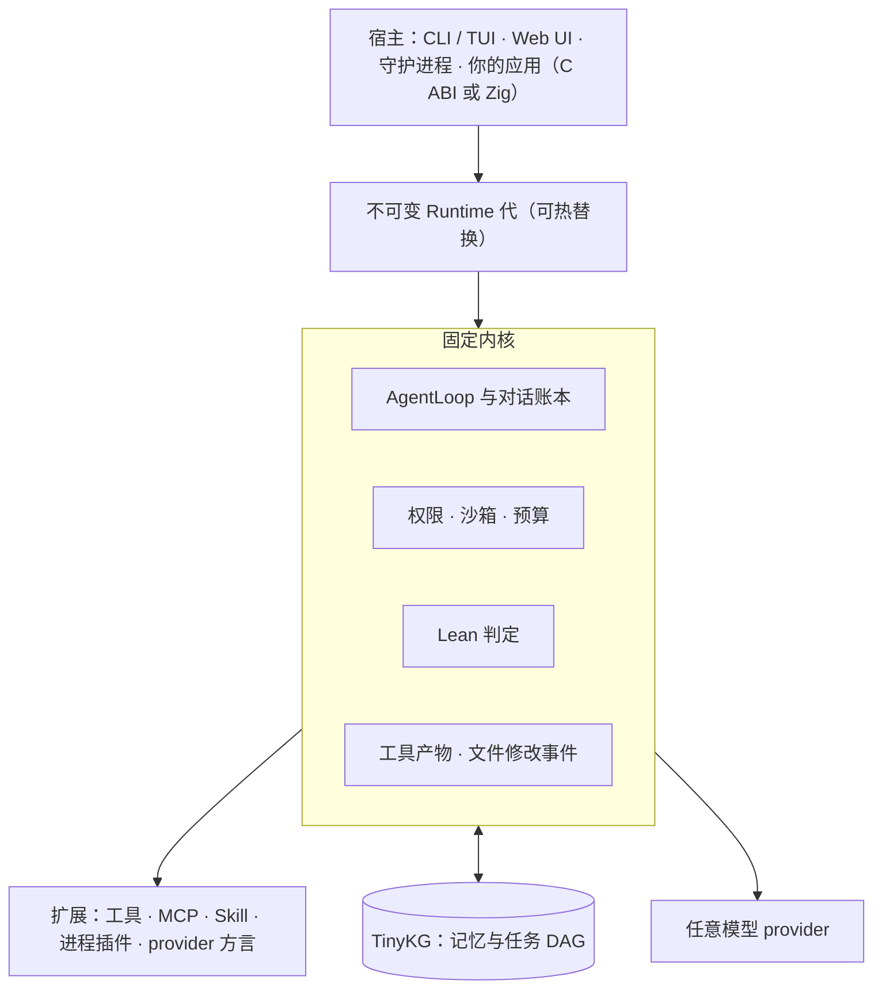

<div align="center">

# metacodes

**可以嵌进任何地方的 agent harness。**

在 WorkBuddy-Bench 上与 CodeBuddy Code、Claude Code 对照评测 · 5.5 MB 原生二进制 · 任何插件都绕不过的固定内核 · 图记忆 · 面向任何宿主的 C ABI

[](https://github.com/metask-ai/metacodes/actions/workflows/ci.yml)
[](https://github.com/metask-ai/metacodes/releases)
[](LICENSE)
[](https://ziglang.org)

[English](README.md) · **简体中文**

</div>

metacodes 是用 Zig 从零写成的 coding agent harness。它今天就能当终端 agent 用，但它是按"库"来设计的：一个固定的 agent loop，权限、预算和形式化判定任何插件都绕不过去；外面包着几层让任何程序都能宿主它的接口：Zig 模块、C ABI（C、C++、Rust、Python、Node 以及任何带 FFI 的语言都能调用）、headless NDJSON、HTTP/UDS 守护进程和 Web UI。

## 为什么还要一个 harness

Agent 正在离开终端。它们正在进入编辑器和桌面应用、CI 流水线、浏览器、游戏和边缘设备，进入成百上千个并行协作、共同拆解一件事的 agent 集群。到那时，harness 不再是一个你打开的应用，而是一块你嵌进去的基础设施，并且同时跑很多份。

今天的大多数 harness 是应用：往往是一个 Node 或 Python 运行时，第一个 token 出来之前就占掉几十到上百 MB 内存，loop 可以配置，却不能链接进你自己的程序。metacodes 站在相反的位置上：

- **harness 是库。** CLI 只是众多宿主之一，下一个宿主可以是你的产品。
- **内核固定、可检验。** 扩展可以增加能力，但永远拿不到放宽安全、预算或判定的权限。
- **每个结论都有测量。** 跑分绑定收据，付费评测绑定预算账本，零结果照样公开。

## 关键数字

2026-10-18 在 Apple Silicon（macOS）上实测，`main` 的 ReleaseSmall 构建；注明了其他来源的两行除外：

| | metacodes |
|---|---|
| 核心二进制 | 5.5 MB（gzip 后 2.6 MB） |
| 暖启动（`--help`） | 5–7 ms |
| 空闲进程峰值 RSS | 2.7 MB |
| 一次 headless 运行，20 轮工具调用，本地 mock 模型 | 峰值 RSS 23 MB |
| 完整发布单元：CLI、TinyKG CLI 与守护进程、两个 Lean 内核、ripgrep | 归档 16.5–20.8 MB（0.5.0 版发布资产） |
| Sealed gateway，64 个并发客户端，mock 模型（2026-10-16，Windows 11，ReleaseFast） | 每秒 1,835 个 agent step；网关自身每步 p50 3 ms / p99 9 ms |
| 原生平台 | Linux x86_64、macOS arm64、Windows x86_64 |

作为参照，同一台机器上 `--help` 的峰值 RSS：Codex CLI 0.163 为 20 MB，Claude Code 2.1.278 为 121 MB。测量方法和限定条件见 [doc/BENCHMARKS.md](doc/BENCHMARKS.md#footprint-snapshot)。

## 质量：与一线 harness 对照

[WorkBuddy-Bench](https://workbuddybench.com/)（腾讯）在真实的代码仓库、Web、办公和安全任务上端到端评测 coding agent。它的榜单显示，同一个模型换一个 harness，分数可能差很多。同一个模型 GLM-5.2 下：

| Harness | Code | Web\* | Office\* | Security |
|---|---:|---:|---:|---:|
| **metacodes 0.1.0**（自测，单次，260/260 题） | 72.7 | 81.1 | 78.8 | 59.0 |
| CodeBuddy Code 2.109.3（官方 v1.2，3 次均值） | 71.5 | 67.4 | 79.6 | — |
| Claude Code 2.1.187（官方 v1.2，3 次均值） | 77.1 | 60.7 | 79.6 | — |

\* 不能跨行比较：我们的 Web 和 Office 用 gpt-5.6-sol（温度 0）判分，官方榜用的是 [Kimi K2.7 Code](https://github.com/Tencent/workbuddy-bench/issues/3)。

能直接对比的是由隐藏测试判分的 Code 列：metacodes 落在两个官方 harness 之间。Security 落后于早先一版榜单（当时 GLM-5.2 为 76.3 和 80.9）。即便是 Code 这个数，也只是参考，不是排名：

- 我们的是单次自测的诊断性复测，对比的是 3 次均值；跑之前 sealed 题集已被分析过，17 笔预算交易中有 10 笔没有通过运行后审计。
- 这次运行没有按官方口径：温度 0、未设 reasoning effort、WebSearch 和 AskUserQuestion 没有关闭。
- headless 模式的 metacodes 每次运行最多 400 轮，两个官方 harness 是 256 轮；那次运行里没有任何一题触到上限。

按官方口径的 3 次运行正在 [#316](https://github.com/metask-ai/metacodes/pull/316) 中准备。

完整审计见 [evals/benchmarks/2026-09-12-metacodes-takeover-audit](evals/benchmarks/2026-09-12-metacodes-takeover-audit/report.md)。[Security 轨迹复核](evals/benchmarks/2026-09-12-security-trajectory-research/report.md)追查了差距来源，发现的评分器缺陷已提交上游（[Tencent/workbuddy-bench#20](https://github.com/Tencent/workbuddy-bench/issues/20)）。补上 Security 这块差距，是贡献者最能出力的地方之一。

## 里面有什么

### 内核固定，其余全部开放

内核负责 agent loop 与对话账本、工具顺序与取消，以及权限、预算、形式化判定和记忆准入。其余一切都是扩展，而扩展只能收紧策略，不能放宽。一个出问题的插件批准不了自己的工具调用，抬不高自己的预算，也伪造不了判定。

### DeepSeek Harness 式的插件灵活性，但 loop 不可替换

metacodes 吸收了 [DeepSeek Harness](https://github.com/deepseek-ai/deepseek-harness) 的 Cordis 运行时里最强的组合思想：

- 稳定的服务身份，依赖显式声明；
- 插件拥有的副作用，失败时逆序回收；
- 有序的 profile 与 bundle 组合。

并在不可变的 Runtime 代（generation）之上实现了它们：

- **热替换。** 整个能力 profile（`minimal`、`offline-coding`、`coding`……）一次事务性发布即可切换，正在运行的会话固定在它开始时的那一代上。
- **四类插件。**
  - 带类型化服务图的静态可信插件；
  - 数据插件（manifest、Skill）；
  - 任意语言写的进程插件：哈希锁定，严格帧协议，带超时和输出上限；
  - provider 方言插件。
- **稳定的 prompt cache。** 模型看到的请求是工具、对话和方言的确定性投影。插件 id、加载路径、时间戳和账本都不会进入请求，所以等价的运行时替换不会让 provider 的 prompt cache 失效。

详见 [PLUGIN_ARCHITECTURE](doc/PLUGIN_ARCHITECTURE.md)、[CORE_PLUGIN_HOTSWAP](doc/CORE_PLUGIN_HOTSWAP.md) 和 [PLUGIN_PROCESS_PROTOCOL](doc/PLUGIN_PROCESS_PROTOCOL.md)。

### 嵌到任何地方

| 接口 | 适用场景 |
|---|---|
| `metacodes-core` Zig 模块 | 同工具链的 Zig 宿主；`zig build example` 运行 [example/main.zig](example/main.zig) |
| AgentCore C ABI v1 revision 25 | [sdk/](sdk/README.md) 自带 C、C++、Zig、Rust 绑定；JNA、.NET P/Invoke 等任何 FFI 都能直接加载共享库 |
| Python 与 Node 包 | `import metacodes` / `require('metacodes')`：Runtime、Session、流式事件、用 Python 或 JavaScript 写工具（[sdk/python](sdk/python/README.md)、[sdk/node](sdk/node/README.md)；实验性） |
| Headless `-p --json` / `--stream-json` | 任何能起子进程、能读 NDJSON 的语言 |
| `serve` 守护进程（HTTP 与 UDS，多会话）和 `--web` | 服务端、桌面应用、远程 UI |

宿主能拿到：

- 会话与运行、类型化事件、运行中追加输入；
- 检查点与恢复、切换模型；
- 权限规则与模式；
- 带 token 预算的目标（goal）；
- MCP 与 Skill；
- 由宿主调度的团队。

从 [doc/API.md](doc/API.md) 开始。

### 为大规模并行而生

- **宿主调度的团队（AgentCore）。** lead 会话只记录派生请求，每个成员会话在哪里跑由你的宿主决定。
- **CLI swarm（`--agent-teams`）。** 队友以线程或 worktree 隔离的进程运行，通过文件邮箱通信，并以原子租约从共享的 TinyKG 任务 DAG 里认领工作。
- **单元足够小。** `serve` 守护进程在一个进程里承载多个会话，并有活跃会话上限。一个忙碌的 headless agent 进程峰值约 23 MB，sealed gateway 在 64 个并发客户端下每步只增加 3 ms（中位数，p99 为 9 ms）。
- **字节稳定的 prompt。** 成千上万个并行运行持续命中 provider 的 prompt cache。

### TinyKG：agent 自己驾驭的图记忆

TinyKG 是 Metask Lab 自研的图存储，用 Zig 编写。它的源码暂未公开：metacodes 以 SHA-256 锁定的二进制形式（Apache-2.0 许可）集成它的 CLI 和守护进程，守护进程在首次使用时自动启动。它给 CLI agent 提供：

- **长期记忆。** `KgRemember`、`KgRecall`、`KgContext`，每条记忆都关联到它来自的任务。
- **持久的任务 DAG。** 有可执行任务的前沿（frontier）、原子认领租约和任务包。swarm 队友就是从这同一个 DAG 里认领工作。
- **不需要 embedding 模型，也不需要向量数据库。** 检索是 BM25 加图遍历，词法变体由模型来写；自动召回最多注入三条短结果。

守护进程不可用时，agent 照常工作，记忆工具会说明原因。目前的证据是内部的、有限的：在需要记忆的任务上，有记忆胜过无记忆；和 Markdown 记忆、向量 RAG 的对比还没有做。TinyKG 目前尚未通过 AgentCore ABI 暴露。

### 基于 Lean 4 的形式化规则（实验性）

项目规则可以在工具派发时交给一个 Lean 编译、哈希锁定的内核裁决，内核预编译在每个发布版里。项目激活规则包之前它保持休眠，见 [control-plane/README.md](control-plane/README.md)。

### 自演化的本体（实验性）

`METACODES_SELF_EVOLUTION=1` 闭合了"本体 → 规则 → 行为 → 观测 → 本体"这个循环：

1. 一次 headless 运行结束后，一次隔离的、有预算上限的模型调用，把这次运行的结果提炼成存进 TinyKG 的临时规则和义务。
2. 下一次运行通过同一个固定内核执行它们。
3. 如果拦截过于频繁，熔断器会把它们全部撤回。

另外，`--learning-turn` 在得到有依据的判定之后记录带条件的经验。这两个特性默认都关闭，也都还没有证明收益。这是项目的研究前沿，欢迎一起来做。

### 兼容你已有的东西

- **与模型无关。** 支持 Anthropic Messages、OpenAI Chat Completions 和 Responses、Gemini，并为 GLM、Kimi、DeepSeek、Qwen、MiniMax 提供模型族适配；自定义的 OpenAI 兼容端点同样可用，包括 loopback 上的本地服务。
- **读取 Claude Code 和 Codex 的配置。** Skill、agent 和 MCP server 配置原样可用。支持 MCP 2026-07-28 以及更早的握手版本。
- **懂语言服务器。** 编辑后有 LSP 诊断，另有 CodeMap 和 FindSymbol。

### 安全与可观测性

- **权限。** 五种模式；allow、ask、deny 规则使用 Claude Code 用户熟悉的 `Tool(specifier)` 语法；受保护路径（`.git`、`.env` 文件、`.ssh`、shell rc 文件等）始终需要确认。
- **沙箱。** 可选启用的 macOS Seatbelt 沙箱；Linux 后端有待贡献。
- **Stall gate。** 交互式会话中默认开启，工具轮次反复拿不到新信息时会停下运行。
- **可观测的输出。** 每次文件修改都是一个带有限长度 diff 的事件；模型输出被分类为 commentary、final、continued、partial 或 discarded。

> **隐私说明。** CLI 默认会调用 Metask 的小型判定模型 Jev 来对自动记忆召回重新排序。每次调用会通过明文 HTTP，把当前请求（最多 400 字节）和最多 8 段脱敏后的记忆片段发送到 Metask 托管的服务器。设置 `METACODES_JEV_URL=off`，或在配置中写 `"jev": false` 即可关闭。嵌入式 AgentCore 运行时除非宿主主动开启，否则不会使用它。见 [doc/JEV_SYSTEM_ONE.md](doc/JEV_SYSTEM_ONE.md)。

## 快速开始

```sh
curl -fsSL https://raw.githubusercontent.com/metask-ai/metacodes/main/scripts/install.sh | sh
```

它会在 macOS（arm64）或 Linux（x86_64）上安装最新发布版。Windows 用 `scripts\install.ps1` 配合发布的 zip 安装。然后：

```sh
metacodes login --provider metask          # 或 --api-key / --provider openai|gemini|zai-coding-plan
metacodes                                  # 交互式 TUI
metacodes -p "explain src/main.zig" --json # headless，输出一条 NDJSON 结果
metacodes --web                            # 浏览器 UI，127.0.0.1:7777
metacodes doctor                           # 查看每个运行时组件从哪里解析
```

从源码构建需要 Zig 0.16：

```sh
git clone https://github.com/metask-ai/metacodes.git && cd metacodes
zig build && ./zig-out/bin/metacodes --help
zig build example                          # 在 Zig 程序里嵌入运行时
```

隔离安装、provider 配置、Metask OAuth、Lean 内核和 Windows 等细节见 [doc/GETTING_STARTED.md](doc/GETTING_STARTED.md)。

## 架构



## 项目状态

metacodes 处于 1.0 之前，版本号以 `build.zig.zon` 为准，每个发布版都为三个平台提供带校验和的产物。

| 部分 | 状态 |
|---|---|
| CLI、headless、Web UI、守护进程 | 日常在用；1.0 前参数仍可能变化 |
| AgentCore C ABI | 实验性；宿主锁定精确的 revision |
| `metacodes-core` Zig 模块 | 实验性源码 API |
| TinyKG 记忆与任务 DAG | CLI 中默认开启；AgentCore 中尚未提供 |
| Lean 项目规则 | 实验性；项目激活前保持休眠 |
| 自演化、learning turn、check gate | 实验性，默认关闭 |
| 沙箱 | 仅 macOS，需手动开启 |

里程碑见 [ROADMAP.md](ROADMAP.md)，开源发布准备情况见 [OPEN_SOURCE_READINESS.md](OPEN_SOURCE_READINESS.md)。

## 谁在做

metacodes 由 Metask Lab 开发，也就是 [Metask](https://app.metask-ai.com)（杭州元任务科技）背后的团队。Metask 所有产品的 agent 引擎都基于它打造，包括 MetaCode、MetaWork 和 Metask Bot。因此有一支全职团队让它在生产环境中持续运转，并跟上新模型的节奏。这个仓库就是那个引擎本身，以 MIT 许可证发布。

## 参与贡献

我们需要贡献者，眼下最有价值的工作是：

- **语言绑定。** Go 绑定、Node 扩展的 Windows 移植、发布 Python 和 Node 包，以及一个 30 行的 C 语言 "hello agent"。
- **质量。** 补上 WorkBuddy Security 的差距，为真实失败编写离线回归用例。
- **记忆研究。** 增加一个 Markdown 记忆或向量 RAG 对照组，与 TinyKG 比较。
- **平台。** Linux 沙箱后端（bubblewrap 或 Landlock），以及 aarch64 Linux、Intel macOS 的发布版。

[CONTRIBUTING.md](CONTRIBUTING.md) 把每个方向对应到具体的入口，并说明改动如何被接受。提交第一个 PR 之前请读一遍 [AGENTS.md](AGENTS.md)，它很短。问题和想法请发到 [Discussions](https://github.com/metask-ai/metacodes/discussions)；安全漏洞请按 [SECURITY.md](SECURITY.md) 私下报告，不要开公开 issue。

## 文档

| | |
|---|---|
| [doc/GETTING_STARTED.md](doc/GETTING_STARTED.md) | 安装、provider、从源码构建 |
| [doc/API.md](doc/API.md) | 所有受支持的入口及其兼容性 |
| [doc/AGENTCORE_BINARY_ABI.md](doc/AGENTCORE_BINARY_ABI.md) | C ABI 的规范性契约 |
| [doc/BENCHMARKS.md](doc/BENCHMARKS.md) | metacodes 如何被测量，以及迄今所有结果 |
| [doc/README.md](doc/README.md) | 全部设计文档索引 |

设计文档以英文为主，部分为中文。

## 许可证

[MIT](LICENSE)。随附的第三方组件保留各自的许可证，见 [THIRD_PARTY_NOTICES.md](THIRD_PARTY_NOTICES.md)。
